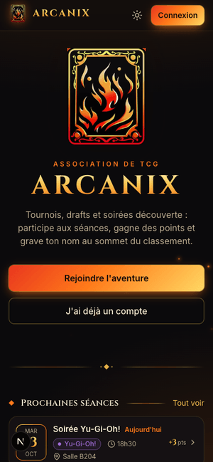

# Arcanix — gestion de l'association TCG

Séances, présences, points et classement de l'association, avec un site web et un bot Discord.

<p align="center"></p>

| Dossier | Rôle | Techno |
|---|---|---|
| `API_TCG_ESGI/` | API REST + migrations | FastAPI, SQLAlchemy 2, Alembic, PostgreSQL 16 |
| `FRONTEND/` | Site (mobile-first, thèmes Obsidienne / Parchemin) | Next.js 15, Tailwind v4, SWR |
| `BOT_DISCORD/` | Bot (inscription, points, appel, annonces) | discord.py 2.5 |

## Démarrage rapide

```bash
cp .env.example .env        # puis remplir : guide détaillé dans docs/CONFIGURATION.md
docker compose up -d --build --remove-orphans   # --remove-orphans arrête les conteneurs de l'ancienne version
```

- Site : http://localhost:3000 — API : http://localhost:8000 (doc interactive sur `/docs`)
- Développement avec rechargement à chaud : `docker compose -f docker-compose.yml -f docker-compose.dev.yml up`
- Données de démonstration (base **vide** uniquement) : `docker compose exec api python -m scripts.seed_demo`
  → comptes `admin@arcanix.fr`, `modo@arcanix.fr`, `membre@arcanix.fr` (mot de passe `arcanix123`)

## Fonctionnalités

- **Membres internes ou externes** : un élève s'inscrit avec son identifiant de l'école (`j.dupont`, le
  suffixe `@myskolae.fr` est ajouté) et sa classe ; un externe avec n'importe quelle adresse, sans classe.
  À la connexion, l'identifiant seul suffit aussi.
- **Séances** : liste et calendrier, filtres par jeu, détail, places limitées.
- **Publication programmée** : pour chaque séance, l'annonce Discord et l'email aux membres partent
  « dès la création », à une date et heure choisies, ou jamais. Les emails sont envoyés par un planificateur
  intégré à l'API (une seule fois par séance) ; chaque membre peut s'en désabonner (profil ou lien dans l'email).
- **« Je viens »** : inscription sur le site ou par bouton sous l'annonce Discord ; liste d'attente avec
  promotion automatique (email + message privé Discord) quand une place se libère.
- **Pointage par QR code** : la modération affiche un QR (page *Pointage QR* d'une séance, plein écran possible) qui
  change toutes les 30 s ; les membres le scannent avec leur téléphone. Le pointage est **en attente** : les pointés
  arrivent pré-cochés dans l'appel et les points ne comptent qu'une fois l'appel validé.
- **Appel rapide** : inscrits et pointés pré-remplis, « Tous présents », enregistrement en une fois.
- **Bonus / malus** : points hors séance avec motif obligatoire (organisation, pénalité…), visibles par le membre.
- **Résultats de tournoi** : place, bilan V-D-N, deck ; un barème (3/2/1 par défaut) attribue les bonus de podium,
  recalculés à chaque correction ; annonce automatique sur Discord.
- **Journal** : chaque présence, point, rôle, séance… avec son auteur et l'heure (*Gestion → Journal*, ou
  *Historique* depuis la fiche d'un membre).
- **Classement** réservé aux élèves : modérateurs, admins et membres externes n'y figurent pas (ni podium,
  ni rôle Top 3) et gardent leurs points sur leur profil. Les exports CSV/JSON (le rendu de points) ne
  contiennent que les élèves, plus la modération listée sans rang ; les externes n'y figurent pas.
- Profil (graphique, historique, notifications).

## Emails (SMTP)

Renseigner `SMTP_*` dans `.env` (fournisseur SMTP, Brevo, OVH, Gmail avec mot de passe d'application…).
Activent : *Mot de passe oublié*, invitation par email à la création d'un compte par la modération,
envoi du lien de mot de passe depuis la fiche d'un membre, alerte « une place s'est libérée ».
Sans SMTP, tout continue de fonctionner (liens via Discord `/reinitialiser` ou copiés par la modération).
En développement, `docker-compose.dev.yml` démarre **Mailpit** : les emails sont visibles sur http://localhost:8025.

## Déploiement derrière Nginx (serveur séparé)

Voir [docs/nginx-arcanix.conf](docs/nginx-arcanix.conf). Points à ne pas oublier :
- `NEXT_PUBLIC_API_BASE` = URL publique de l'API (le navigateur l'appelle directement), `FRONTEND_URL` et
  `CORS_ORIGINS` = URL publique du site ;
- `FORWARDED_ALLOW_IPS` = IP locale de la **VM Nginx** (pas celle de la VM Docker), sinon la limitation des tentatives de connexion verra
  l'IP de Nginx pour tout le monde ;
- n'exposer les ports 3000/8000 du serveur Docker qu'au serveur Nginx (pare-feu).

## Première mise en service (base neuve)

1. `docker compose up -d --build` : au démarrage, l'API crée tout le schéma (migrations Alembic).
2. **Créer le premier admin** (personne ne peut le devenir depuis le site) :
   ```bash
   # Créer le compte (mot de passe saisi au clavier, jamais en argument)
   docker compose exec -it api python -m scripts.creer_admin --email toi@exemple.fr --prenom Prénom --nom Nom --classe 5A
   # …ou recevoir un lien pour choisir le mot de passe sur le site
   docker compose exec api python -m scripts.creer_admin --email toi@exemple.fr --prenom Prénom --nom Nom --classe 5A --lien
   # …ou promouvoir un compte déjà inscrit (site ou /register sur Discord)
   docker compose exec api python -m scripts.creer_admin --email toi@exemple.fr
   ```
3. Se connecter, créer le premier semestre (*Gestion → Semestres*, il devient automatiquement « en cours »),
   puis nommer les modérateurs depuis *Gestion → Membres*.

> ⚠️ Si l'ancienne version a tourné sur le même serveur, son volume Docker `postgres_data` contient encore
> l'ancienne base : elle serait reprise (et migrée) telle quelle. Pour repartir de zéro, supprime ce volume
> **après** t'être assuré de ne plus en avoir besoin (`docker volume ls`, puis `docker volume rm <nom>`).

Sauvegarde ponctuelle : `docker compose exec db pg_dump -U admin pointsdb > sauvegarde_$(date +%F).sql`

Le schéma est géré par **Alembic** (`API_TCG_ESGI/alembic/versions`) et appliqué à chaque démarrage. Une base
de l'ancienne version serait aussi reconnue et migrée sans perte (voir `0002_refonte.py`).

## Sécurité

- Sessions JWT signées par `JWT_SECRET`, valables `JWT_EXPIRE_DAYS` jours.
- Connexion limitée à 10 échecs par quart d'heure (par IP et email), réponse 429 au-delà.
- Liens de mot de passe et codes Discord à usage unique, stockés hachés, avec expiration.
- Routes du bot protégées par le secret partagé `DISCORD_BOT_TOKEN`.

## Rôles

| Rôle | Peut… |
|---|---|
| `user` | voir les séances, son profil, ses points, le classement ; lier son Discord |
| `moderator` | + créer/modifier/supprimer les séances, faire l'appel, gérer les membres (`user` uniquement), exports |
| `admin` | + rôles, suppression de comptes, semestres (dont « semestre en cours ») |

## Bot Discord

1. Dans le [portail développeur](https://discord.com/developers/applications), régénérer le token du bot et le mettre dans `DISCORD_TOKEN`.
2. Mettre la même valeur aléatoire dans `DISCORD_BOT_TOKEN` (secret partagé API ↔ bot).
3. Renseigner `DISCORD_GUILD_ID` (commandes disponibles immédiatement), puis un salon par sujet :
   `DISCORD_ANNONCES_CHANNEL_ID` (séances, rappels) et `DISCORD_POINTS_CHANNEL_ID` (résultats, podium).
4. `FRONTEND_URL` doit être l'URL **publique https** du site pour que les liens et le logo s'affichent dans Discord.

| Commande | Effet |
|---|---|
| `/register` | Formulaire d'inscription → lien privé pour choisir son mot de passe. Email : identifiant de l'école (`j.dupont`) = élève, classe obligatoire ; adresse perso = externe, sans classe |
| `/lier code` | Lie un compte créé sur le site (code généré sur la page Profil) |
| `/reinitialiser` | Nouveau lien de mot de passe |
| `/points` | Points, rang et présences du semestre en cours |
| `/profil [membre]`, `/historique` | Fiche d'un membre, 10 dernières séances |
| `/classement [semestre]` | Top 10 (public) + ta position |
| `/seances` | Prochaines séances |
| `/mod seance [jeu]` | Créer une séance (formulaire) |
| `/mod presence seance` | Valider jusqu'à 25 présents d'un coup (sélecteur de membres) |
| `/mod points membre points motif` | Bonus (ou malus si négatif) avec motif |
| Boutons sous les annonces | « Je viens » / « Je ne viens plus » (fonctionnent même après un redémarrage du bot) |

Les commandes `/mod` sont masquées par défaut aux membres sans la permission « Gérer les événements » ;
on peut les ouvrir à un rôle dans *Paramètres du serveur → Intégrations → Arcanix*. Dans tous les cas,
l'API vérifie que l'auteur est `moderator` ou `admin` sur le site (compte lié).

**Publications automatiques** (toutes les 5 min), chacune dans son salon :

| Salon | Contenu |
|---|---|
| Annonces (`DISCORD_ANNONCES_CHANNEL_ID`) | nouvelle séance et rappel la veille, avec boutons d'inscription |
| Points (`DISCORD_POINTS_CHANNEL_ID`, sinon le salon des annonces) | résultats de tournoi, podium du semestre quand un admin définit un nouveau « semestre en cours » |
| Points, via `DISCORD_WEBHOOK_URL` (optionnel, envoyé par l'API) | présences validées depuis le site et points gagnés |

**Rôles automatiques** (optionnels) :
- `DISCORD_ROLE_MEMBRE_ID` : donné dès `/register` ou `/lier` ;
- `DISCORD_ROLE_TOP3_ID` : attribué aux 3 premiers du semestre en cours et retiré aux autres (toutes les 15 min).

Le bot a besoin de la permission **Gérer les rôles**, et son rôle doit être **au-dessus** de ces rôles dans la
liste des rôles du serveur. La synchronisation périodique (top 3) nécessite d'activer l'intent privilégié
**Server Members** : *Developer Portal → ton application → Bot → Privileged Gateway Intents*.

## Tests

```bash
# API (Postgres requis ; la base de test est recréée)
docker compose run --rm -e TEST_DATABASE_URL=postgresql+psycopg://admin:<mdp>@db:5432/arcanix_test api pytest -q
# Bot, sans Discord : chaque commande est exécutée avec de fausses interactions
cd BOT_DISCORD && pip install -r requirements-dev.txt && python -m pytest -q
# Bot de bout en bout contre une vraie API (base remplie avec scripts.seed_demo)
ARCANIX_E2E_API=http://localhost:8000 ARCANIX_E2E_BOT_TOKEN=<DISCORD_BOT_TOKEN> python -m pytest tests/test_e2e.py -v
# Frontend
cd FRONTEND && npm ci && npx tsc --noEmit && npm run lint && npm run build
```
